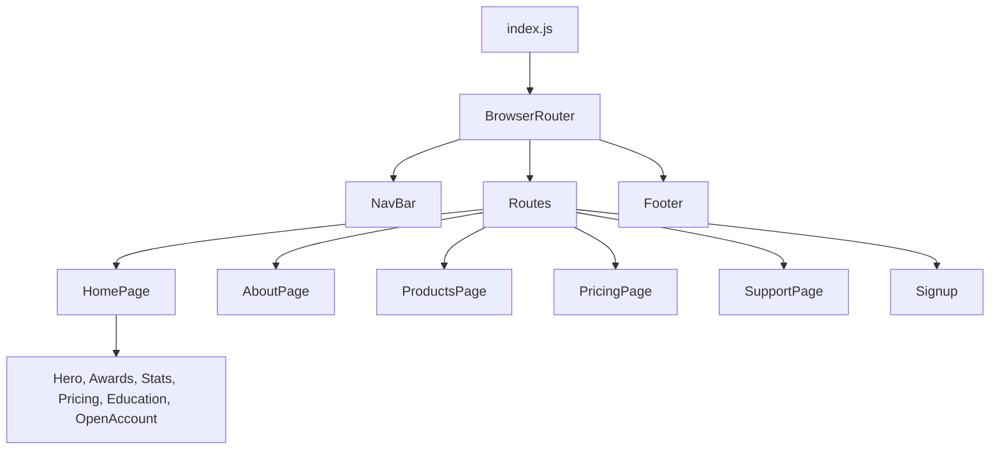

# Trade Vertex One


A front-end learning project that implements the marketing website of a fictional stock brokerage, built as a single-page application with React, React Router, and Bootstrap.

> **Disclaimer:** Trade Vertex One is a fictional brand created for educational purposes. It is not a registered broker and offers no financial services or trading functionality. The company details, statistics, charges, and regulatory text shown in the application are placeholder content and must not be relied upon.

## Overview

The project is organized as a component-based landing site, with client-side routing, a shared navigation bar and footer, and a separate directory of components for each page. The home page is fully implemented, and the remaining pages are scaffolded with their component structure in place.

## Key Features

- Single-page navigation with client-side routing across six routes
- Shared navigation bar and footer rendered around all pages
- Composable home page built from independent section components
- Grid-based layout and collapsible navigation using Bootstrap 5
- Production build through Create React App

## Development Status

| Route | Page Component | Status | Sections |
| --- | --- | --- | --- |
| `/` | `HomePage` | Implemented | Hero, Awards, Stats, Pricing, Education, OpenAccount |
| `/about` | `AboutPage` | Scaffolded | Hero, Team |
| `/products` | `ProductsPage` | Scaffolded | Hero, LeftSection, RightSection, Universe |
| `/pricing` | `PricingPage` | Scaffolded | Hero, Brokerage |
| `/support` | `SupportPage` | Scaffolded | Hero, CreateTicket |
| `/signup` | `Signup` | Scaffolded | Signup |

Scaffolded components render a placeholder heading and are ready for their content. A `NotFound` component is also included and is not yet connected to a route.

## Technology Stack

| Component | Technology |
| --- | --- |
| UI library | React 19 |
| Routing | React Router 7 (`BrowserRouter`, `Routes`, `Route`) |
| Styling | Bootstrap 5.3, loaded from a CDN |
| Icons | Font Awesome Free 7.1 (see [Configuration](#configuration)) |
| Build tooling | Create React App (`react-scripts` 5) |

## Architecture and Workflow

The application mounts in `frontend/src/index.js`, which wraps the navigation bar, the route table, and the footer in `BrowserRouter`. The active route selects a page component, and that page composes its own section components.



## Project Structure

```text
Trade-Vertex-One/
├── frontend/
│   ├── public/
│   │   ├── media/images/       Static images and logos
│   │   ├── index.html
│   │   └── manifest.json
│   ├── src/
│   │   ├── landingPage/
│   │   │   ├── About/
│   │   │   ├── Home/
│   │   │   ├── Pricing/
│   │   │   ├── Products/
│   │   │   ├── Signup/
│   │   │   ├── Support/
│   │   │   ├── Footer.js
│   │   │   ├── NavBar.js
│   │   │   ├── NotFound.js
│   │   │   └── OpenAccount.js
│   │   ├── index.css
│   │   └── index.js
│   ├── package-lock.json
│   └── package.json
└── README.md
```

## Installation and Setup

### Prerequisites

- Node.js and npm

### Install

```bash
git clone https://github.com/Partha-Shankar/Trade-Vertex-One.git
cd Trade-Vertex-One/frontend
npm install
```

## Configuration

The application requires no environment variables.

Bootstrap is loaded from a CDN, so an internet connection is needed during development. `public/index.html` loads Font Awesome from a local directory that is not stored in the repository. To display the icons, download the [Font Awesome Free 7.1.0 web package](https://fontawesome.com/download) and extract it to `frontend/public/fontawesome-free-7.1.0-web/`.

## Usage

Run these commands from the `frontend` directory.

| Command | Purpose |
| --- | --- |
| `npm start` | Starts the development server at `http://localhost:3000` |
| `npm run build` | Creates an optimized production build in `frontend/build` |

## Technical Implementation

### Component Organization

Each page has its own directory under `src/landingPage`, containing a page component that composes smaller section components. Components shared across pages, such as `NavBar`, `Footer`, and `OpenAccount`, sit at the top level of that directory.

### Routing

`NavBar` uses the React Router `Link` component, so navigation between pages happens on the client without a full page reload.

### Styling

Layout relies on Bootstrap's grid and utility classes, with inline style objects for section-specific spacing and sizing.

## Future Scope

- Implementing the content of the scaffolded About, Products, Pricing, Support, and Signup pages
- Connecting the `NotFound` component to a catch-all route
- Linking the home page calls to action and footer entries to their destinations

## Third-Party Assets

Third-party names, logos, and images in `frontend/public/media/images` belong to their respective owners and are used here for educational purposes only.
